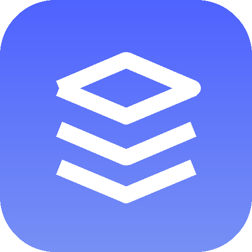
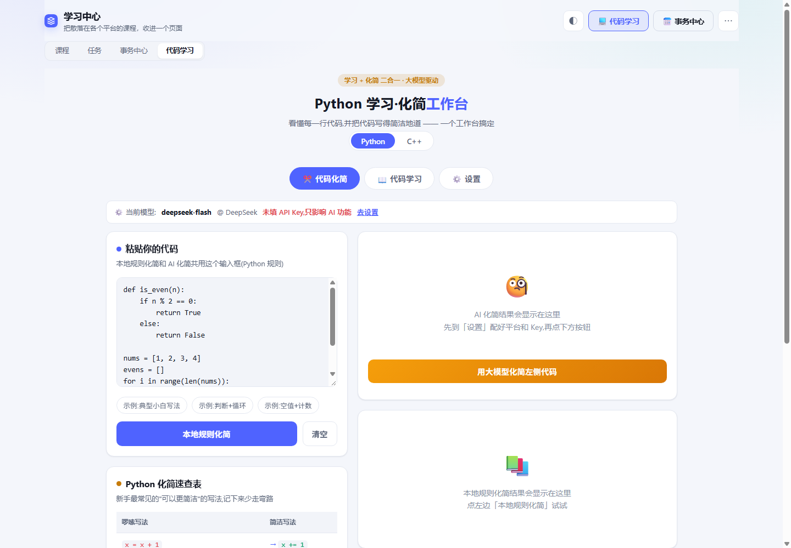
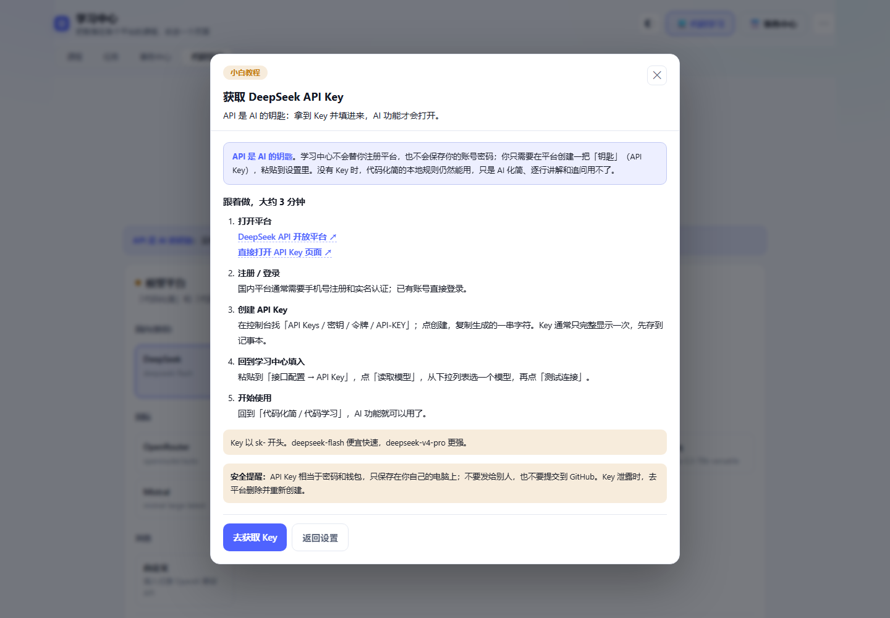
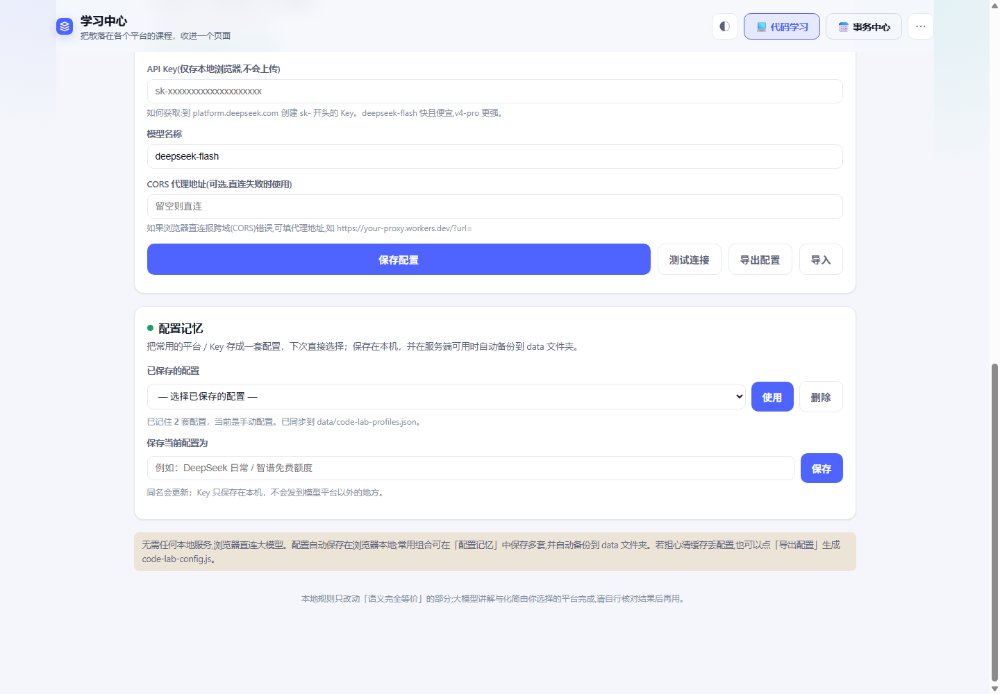

# 学习中心 · Learning Hub



把散落在**雨课堂、学习通、智慧树、中国大学 MOOC、小雅、B 站、YouTube** 上的课程，
收进一个本地页面；课程之外，还内置一个 **Python / C++ 代码学习与化简工作台**。

课程与事务数据零依赖、纯离线，只存在自己电脑上；代码学习台的 AI 功能需要你自己配置模型。

**[下载便携版](../../releases/latest)** · **[使用手册](docs/使用指南.md)**

---

## 它解决什么问题

课程表在雨课堂，作业在学习通，录播在 B 站，参考资料在 YouTube——
每次找作业得在四五个平台之间来回跳，还容易忘掉截止时间。

这个工具**不替你抓取数据、也不绕过登录**，只做一件事：

> 把「入口」和「截止时间」集中到一个页面，点一下回到平台原网页。

数据是你自己填的（或者用扩展一键收进来的），所以平台改版时不会整个崩掉。

课程之外，**看不懂的代码、写得啰嗦的代码**也不用再开一堆 AI 网页：内置的「代码学习」工作台可以逐行讲解、按行追问、按等价规则化简，并保留学习历史。

## 功能

### 课程与任务

- **课程卡片墙**：进度、状态、颜色、备注，一眼看完这学期在学什么
- **任务列表**：按课程分组，组内按截止时间从近到远，最近的排最前
- 任务可以**绑定具体网址**（某次作业的详情页），点任务直接打开那一页
- 勾选完成 · 编辑（改名 / 改时间 / 改绑定）· 删除

### 事务（日历版待办）

除课程作业之外，还有一套独立的个人待办：

- **月历 / 列表**两种视图，点日历格子直接新建
- 课程截止事项会**叠在同一张月历**上，作业和私事不用分两处看
- 分类（作业 / 日程 / 个人，可自建）、优先级、备注
- **附件**：拖拽上传，单条最多 20 个
- 统计圆环、搜索
- 顶部有 **📅 事务中心** 一级入口；菜单里内置「检查更新」，服务端每 30 分钟自动查一次，发现新版本会直接在界面提示，不用自己反复点

### 代码学习（内置工作台）

课程之外，学习中心里还固定带一个代码学习台，不需要另开程序：




- **Python / C++ 双语言**：语法高亮、示例、速查表、AI 提示词全部随语言切换
- **本地规则化简**：只改语义完全等价的写法（`x = x + 1` → `x += 1`、`len(x) == 0` → `not x`、`s.size() == 0` → `s.empty()` 等），逐条给出原写法、化简后、为什么和思考过程
- **AI 化简**：接 OpenAI 兼容接口，输出完整代码 + 逐条改动理由；支持流式讲解
- **逐行解释 + 行内追问**：按行号提问，AI 结合上下文回答
- **学习历史**：自动保存在浏览器本地，可回看、删除、导出 / 导入
- **配置自动保存**：API 地址 / Key / 模型 / CORS 代理自动存本地；可导出 `code-lab-config.js` 放到 `data/` 作为永久备份
- **配置记忆**：把常用平台 / Key 存成多套，代码页顶部直接切换；本机 localStorage + `data/code-lab-profiles.json` 双备份，清缓存/换浏览器也能恢复
- **API 开放平台直达**：常用平台的 API 控制台以蓝色链接列出，点一下就到注册 / 创建 Key 的地方
- **小白教程**：设置页不堆长文，点「获取 API 小白教程」进入二级介绍页，按步骤讲清楚「API 是 AI 的钥匙」和怎么创建 Key
- **读取平台模型**：填好地址和 Key 后点「读取模型」，自动列出该平台的全部模型，直接下拉选择，不用自己记模型名
- 顶部 **💻 代码学习** 一级入口，或直接访问 `/?view=code`；界面跟随学习中心的浅色 / 深色主题





### 快速入口

- 顶部「平台入口」按平台自动聚合
- **＋ 自定义网址**：教务系统、图书馆这类不属于课程的链接

### 浏览器扩展（Manifest V3）

- 任意网站注入浮动按钮，**可拖动**，位置会记住
- **收进学习中心**：读出当前页的作业名、截止时间、学习进度，确认后入库
- **记住此页**：存成课程入口，或直接绑到某条任务
- 已知平台和所有 `*.edu.cn` 学校站点直接展开；其它网站收成一个小圆点，不挡内容

### 其它

- 本地网页 + 可「安装为应用」，独立窗口运行
- **应用内更新推送 + 自更新**：服务端后台定时检查，发现新版本通过 SSE 实时推到页面——顶部提示条 + 菜单小红点 + 可选系统通知；点「立即更新」只下载有变化的程序文件（通常几百 KB），自动重启，失败自动回滚，不用每次重下 31MB 完整包
- 可选访问密码（scrypt 散列）、导出 / 导入备份
- 便携包内置 Node 运行时，解压即用，不用装任何东西

## 快速开始

### 方式一：下载便携版（推荐）

1. 到 **[Releases](../../releases/latest)** 下载 `learning-hub-portable.zip`（约 31MB）
2. 解压到任意位置，双击 **`启动.bat`**
3. 自动打开一个没有地址栏的窗口

> Windows 可能提示「已保护你的电脑」：右键 zip → 属性 → 勾选「解除锁定」，
> 或运行时点「更多信息 → 仍要运行」。这是未签名程序的通用提示，不代表有风险。
>
> GitHub 会过滤附件名里的中文，发布时 CI 会把它们改成 `learning-hub-portable.zip` /
> `learning-hub-code.zip`；本地构建产物仍然是 `学习中心-便携版.zip` / `学习中心-代码更新包.zip`。

> **已经装过旧版？** 不用重下 31MB：到 Releases 下载 `learning-hub-code.zip`（约 0.2MB），
> 解压覆盖原来的「学习中心」文件夹即可（保留 `node/` 和 `data/`）。装到 2.6.0 后，
> 后续版本直接在应用里点「立即更新」，只下载变化的文件。

### 方式二：从源码运行

需要 Node.js ≥ 18：

```bash
git clone https://github.com/Reese-X08/learning-hub.git
cd learning-hub
node server.js
```

然后打开 <http://127.0.0.1:4173>。

| 环境变量 | 默认 | 说明 |
| --- | --- | --- |
| `PORT` | `4173` | 监听端口 |
| `HOST` | `0.0.0.0` | 改成 `127.0.0.1` 只允许本机访问 |

### 安装浏览器扩展

1. 打开 `edge://extensions`（Chrome 是 `chrome://extensions`）
2. 打开「开发人员模式」
3. 点「加载解压缩的扩展」，选择仓库里的 `extension/` 文件夹
4. **先启动本地程序**，再打开课程网站点右下角按钮

## 数据与隐私

| 项 | 说明 |
| --- | --- |
| 数据位置 | 程序目录下的 `data/db.json`（纯文本 JSON） |
| 代码学习配置 | API Key / 模型 / 接口地址存在浏览器 localStorage；常用组合另存 `data/code-lab-profiles.json`（只有登录后才能读取，含 Key），也可手动导出 `code-lab-config.js` |
| 代码学习历史 | 存在浏览器 localStorage（`wb_py_allinone_history`），不进 `db.json`；可用工作台里的「导出记录」备份 |
| 密码 | 只保存 scrypt 散列，不存明文 |
| 网络 | 便携版默认只监听 `127.0.0.1`，外部访问不到 |
| 扩展 | 只读取当前标签页的文字，发送到 `127.0.0.1` 的本地程序 |
| 遥测 | **没有任何遥测**，不向任何服务器发送数据 |
| AI 请求 | 浏览器直接请求你配置的模型平台；学习中心服务端不中转、不保存对话和 Key |
| 更新检查 | 只请求 `version.json` / `update-manifest.json` / Releases 里的版本号和文件清单，不发送本地数据 |
| 自动更新 | 只下载 `server.js`、`lib/`、`public/` 等程序文件，SHA-256 校验后才替换；不碰 `data/` 和 `node/` |
| 账号 | 不读取、不保存你在各平台的账号密码 |

> 直接用 `node server.js` 启动时默认监听 `0.0.0.0`，同一 WiFi 可访问——
> 这时请务必在「站点设置」里打开密码。

## 技术栈

刻意保持极简，没有框架、没有构建步骤：

| 部分 | 实现 | 规模 |
| --- | --- | --- |
| 服务端 | Node 原生 `http` + JSON 文件存储，零第三方依赖 | ~2500 行 |
| 前端 | 原生 JS / CSS，无框架、无构建步骤；代码学习台挂在 Shadow DOM 里 | ~7400 行 |
| 扩展 | Manifest V3，原生 JS | ~510 行 |

## 目录结构

```
├── server.js               # HTTP 服务：静态文件 + 登录 + 课程/任务 API + SSE
├── lib/store.js            # 数据层：校验、读写、原子写盘
├── lib/updates.js          # 更新检查：多线路轮询、版本比较、SSE 推送
├── lib/self-update.js      # 自更新：只下载变化的文件、校验、备份与回滚
├── lib/restart-helper.js   # 自更新重启助手：健康检查、失败回滚
├── update-manifest.json    # 自更新文件清单（发版时由 CI 生成）
├── public/                 # 前端（可安装为 PWA）
│   ├── code-lab.js         # 代码学习台：化简 / 逐行讲解 / 追问 / 历史
│   ├── code-lab.css        # 代码学习台样式（Shadow DOM 内生效）
├── extension/              # 浏览器扩展
├── templates/              # 打包时放进 zip 的说明和空白数据模板
├── tools/build-package.ps1 # 一键打包：程序 + Node → zip
├── docs/使用指南.md         # 完整使用手册
└── data/                   # 运行时生成（含个人数据，已 gitignore）
    ├── db.json            # 课程、事务、分类、设置
    └── code-lab-profiles.json  # 代码学习配置记忆（可选，含 API Key）
```

## 开发

```bash
node server.js        # 本地起服务
npm test              # 更新 / 自更新 / 清单 / 代码学习与配置记忆
npm run manifest      # 重新生成 update-manifest.json
npm run build         # 打便携包（首次会自动下载 Node 运行时）
```

发版：改 `package.json` 和 `version.json` 里的版本 / 说明，提交后

```bash
git tag v2.9.0
git push --tags
```

GitHub Actions 会自动打包并发布 Release（见 `.github/workflows/release.yml`）。

## 已知限制

- 平台上作业的页面结构一变，自动提取就可能失效——所以**保留了人工确认那一步**
- 只读当前标签页；iframe 内嵌的跨域内容读不到
- 便携版是 `.bat` + 未签名的 `node.exe`，Windows 会提示一次；没有购买代码签名证书
- 更新检查要能访问 GitHub / jsDelivr；都连不上时界面会显示「暂时连不上更新服务」，不影响正常使用，恢复网络后会自动重试
- **代码学习配置记忆含 API Key**：本机 localStorage 和 `data/code-lab-profiles.json` 都是明文，注意不要把 data 文件夹发给别人
- **代码学习台的 AI 功能需要你自己准备 API Key**；国内 DeepSeek / 智谱 / 通义 / Kimi / 硅基流动和 OpenRouter 已实测支持浏览器直连，其它平台可能需要 CORS 代理
- **从 2.5.1 升到 2.6.0 仍然要手动覆盖一次代码更新包**（老版本没有自更新代码，约 1MB，不用重下 31MB 完整包）；从 2.6.0 起，后续版本都可以在应用内一键更新
- 应用内更新要求更新源旁边有 `update-manifest.json`；自己搭的更新源只放 `version.json` 时，界面会退回「下载完整包」
- 更新检查走 Node 自己的 HTTPS，不读浏览器的代理设置；公司网络要求代理或自签证书时可能查不到，但课程和事务不受影响

## 免责声明

本项目与雨课堂、超星学习通、智慧树、中国大学 MOOC 等平台**没有任何关联**，
也不是任何平台的官方客户端。

它不绕过登录、不破解权限，只读取你在浏览器里**已经看到**的页面文字，
并把数据存在你自己的电脑上。请遵守所在平台的服务条款。

## License

[MIT](LICENSE)
